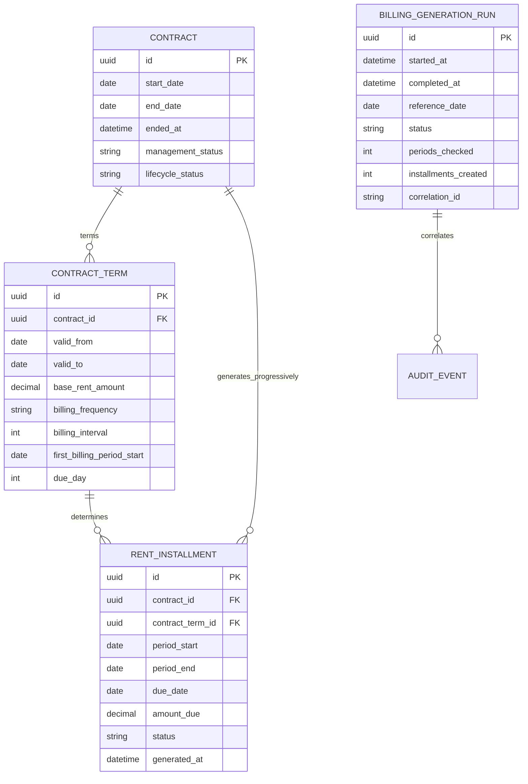

# GestioneImmobili
## Entity Relationship Diagram

**Versione:** 1.2  
**Derivato da:** Modello Dati Logico v1.3

## 1. Dominio Contratti e generazione Canoni


## 2. Vincoli
- `CONTRACT_TERM.first_billing_period_start` obbligatorio per un Contratto attivabile.
- `first_billing_period_start >= CONTRACT.start_date` nell'MVP senza prorata.
- Un solo `CONTRACT_TERM` valido a una data.
- UNIQUE `(contract_id, period_start, period_end)`.
- Il `contract_term_id` del Canone appartiene al medesimo Contratto.
- Nessun Canone con `period_start` successivo alla cessazione effettiva.
- Il generatore recupera periodi mancanti e non dipende dall'esecuzione esatta nel primo giorno.

## 3. Esempio mensile
```text
Contratto decorre: 15/01/2027
Prima mensilità:   01/02/2027
Periodicità:       MONTHLY
Due day:           5

Canone Febbraio:
period_start       01/02/2027
period_end         28/02/2027
due_date           05/02/2027
generated_at       01/02/2027 o al primo recupero successivo
```

## 4. Coerenza con ERD v1.1
Tutte le altre entità e relazioni dell'ERD v1.1 restano invariate. La v1.2 modifica esclusivamente il sottodominio di generazione Canoni e aggiunge `BILLING_GENERATION_RUN`.
