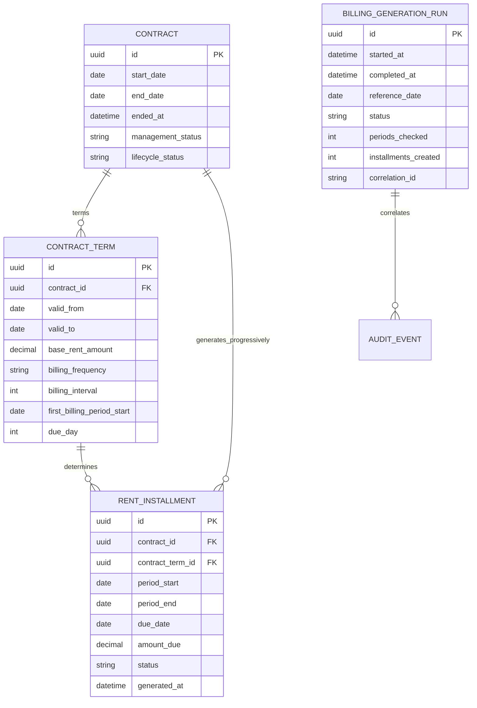

# GestioneImmobili
## Entity Relationship Diagram

**Versione:** 1.2  
**Derivato da:** Modello Dati Logico v1.3

**Stato:** diagramma focalizzato sul sottodominio Canoni; per il perimetro complessivo e lo stato implementato vedere la sezione 5.

## 1. Dominio Contratti e generazione Canoni


## 2. Vincoli
- `CONTRACT_TERM.first_billing_period_start` obbligatorio per un Contratto attivabile.
- `first_billing_period_start >= CONTRACT.start_date` nell'MVP senza prorata.
- Un solo `CONTRACT_TERM` valido a una data.
- UNIQUE `(contract_id, period_start, period_end)`.
- Il `contract_term_id` del Canone appartiene al medesimo Contratto.
- Nessun Canone con `period_start` successivo alla cessazione effettiva.
- Il generatore recupera periodi mancanti e non dipende dall'esecuzione esatta nel primo giorno.

## 3. Esempio mensile
```text
Contratto decorre: 15/01/2027
Prima mensilità:   01/02/2027
Periodicità:       MONTHLY
Due day:           5

Canone Febbraio:
period_start       01/02/2027
period_end         28/02/2027
due_date           05/02/2027
generated_at       01/02/2027 o al primo recupero successivo
```

## 4. Ambito del diagramma
Questo diagramma rappresenta il sottodominio Contratti/Canoni e non è un ERD completo dello schema Supabase. Non si presume che tutte le entità del modello logico o dei requisiti siano già implementate.

## 5. Inventario relazionale presente nel database (2026-10-31)

Le migration sono l'autorità per colonne, vincoli e FK. Il seguente inventario amplia l'ambito del diagramma senza sostituire la definizione DDL.

| Area | Tabelle presenti | Relazioni principali |
|---|---|---|
| Identità/accessi | `profiles`, `owners`, `invitations`, `invitation_owners`, `user_owner_accesses`, `legal_documents`, `legal_document_versions`, `legal_acceptances`, `data_subject_requests` | Profile → Auth user; accesso utente → Owner; inviti e accettazioni legati ai profili. |
| Patrimonio | `properties`, `property_ownerships`, `rentable_spaces` | Proprietà → quote e porzioni; quote collegano Owner e Property. |
| Locazioni | `tenants`, `contracts`, `contract_rentable_spaces`, `contract_tenants`, `contract_terms`, `contract_changes` | Contratto → Property, termini, locatari, porzioni ed eventi di variazione. |
| Canoni/incassi | `rent_installments`, `rent_installment_components`, `receipts`, `receipt_allocations`, `billing_generation_runs` | Contratto/termine → rate; Incasso ↔ rate tramite allocazioni. |
| Spese | `expenses`, `expense_allocations`, `expense_payments`, `owner_settlement_items` | Spesa → quote di competenza, pagamenti e conguagli tra Owner. |
| Documenti | `documents`, `document_versions`, `owner_documents`, `property_documents`, `rentable_space_documents`, `tenant_documents`, `contract_documents`, `rent_installment_documents`, `receipt_documents`, `expense_documents`, `deadline_documents` | Documento → versioni e collegamenti tipizzati alle entità. |
| Operazioni | `deadlines`, `notification_rules`, `notification_deliveries`, `audit_events`, `security_events`, `idempotency_keys` | Scadenze → regole/consegne; audit e chiavi idempotenza tracciano operazioni. |

### Relazioni del sottodominio economico
- `RECEIPT` e `RENT_INSTALLMENT` hanno relazione molti-a-molti attraverso `RECEIPT_ALLOCATION`.
- `EXPENSE` ha più `EXPENSE_ALLOCATION` e può avere più `EXPENSE_PAYMENT`.
- `OWNER_SETTLEMENT_ITEM` collega un creditore e un debitore e può riferirsi a una spesa.
- `DOCUMENT` ha una o più `DOCUMENT_VERSION`; i bridge tipizzati associano documenti alle entità senza una relazione polimorfica unica.
- `BILLING_GENERATION_RUN` registra esecuzioni del generatore; `correlation_id` non è una FK verso `AUDIT_EVENT`, quindi non definisce una relazione referenziale 1:N.

Le tabelle per inviti, privacy, notifiche e scadenze sono presenti nello schema, ma non tutte dispongono di flussi applicativi completi. Lo schema non include tabelle `user_notification_preferences`, `message_templates` o `message_template_translations`.
